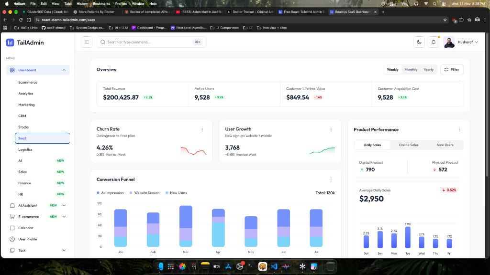
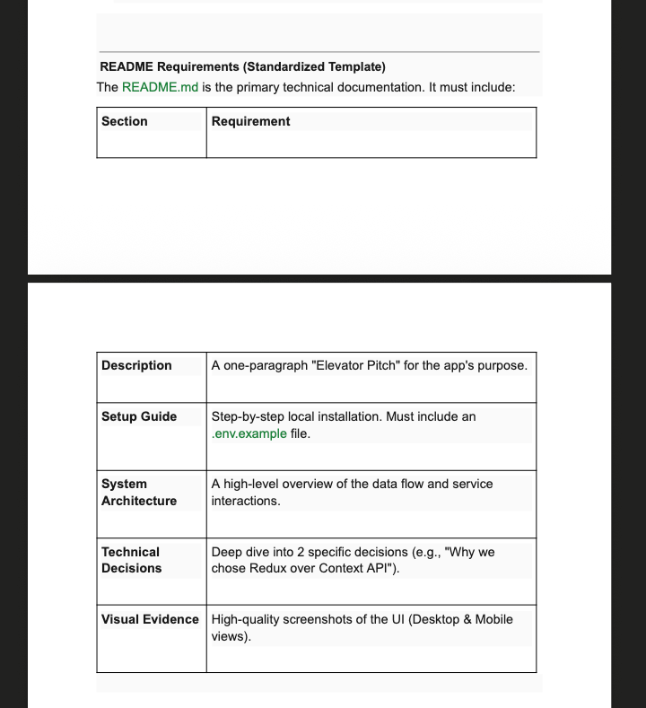

# Doctor Tracker Dashboard

---

## 1️⃣ Description

*A modern, TailAdmin‑styled dashboard that lets health‑administrators manage doctors and patients in a clean, responsive UI. Built with **Next.js (React 18)**, **shadcn UI**, **TypeScript**, and **Tailwind CSS**, it communicates with a separate Express/TS backend to handle authentication, CRUD operations, and server‑side pagination.*

---

## 2️⃣ Setup Guide

### Prerequisites

- **Node.js** ≥ 18 (recommended LTS) and **npm** ≥ 9 (or **yarn**).
- **MongoDB** instance – local or remote (the backend expects a `MONGODB_URI`).
- **Git** for cloning the repositories.

### Clone the repositories

```bash
# Front‑end
git clone <your‑frontend‑repo‑url> doctor-tracker-client
cd doctor-tracker-client

# Back‑end (sibling folder)
git clone <your‑backend‑repo‑url> doctor-tracker-server
cd ../doctor-tracker-server
```

### Install dependencies

```bash
# Front‑end
cd ../doctor-tracker-client
npm install   # or `yarn`

# Back‑end
cd ../doctor-tracker-server
npm install   # or `yarn`
```

### Environment configuration

Both projects ship an **`.env.example`** file. Copy it to `.env` (frontend) and `.env` (backend) and adjust values if necessary.

```bash
# Front‑end
cp .env.example .env   # creates the required variables
# Backend (inside doctor‑tracker‑server)
cp .env.example .env
```

**`.env.example` (frontend)**
```env
# Backend API URL (Express server)
NEXT_PUBLIC_BACKEND_API_URL=http://localhost:3001
BACKEND_API_URL=http://localhost:3001
API_URL=http://localhost:3001/api
```

**Backend `.env.example`** (the back‑end already contains a similar file; ensure the same values are set).

### Run the applications

```bash
# Terminal 1 – backend
cd doctor-tracker-server
npm run dev   # starts Express on http://localhost:3001

# Terminal 2 – frontend
cd ../doctor-tracker-client
npm run dev   # starts Next.js on http://localhost:3000
```

Open `http://localhost:3000` in your browser.  You can register a new account, log in, and explore the dashboard, doctor directory, and patient directory.

---

## 3️⃣ System Architecture

```mermaid
flowchart TD
    A[Browser] -->|HTTP (GET/POST)| B[Next.js Front‑end]
    B -->|Auth cookie (httpOnly)| C[Express Backend]
    C -->|MongoDB queries| D[MongoDB]
    B -->|Server‑side Props| E[Next.js Middleware (proxy.ts)]
    E -->|Redirects unauthorized| B
    B -->|Fetch data (doctors/patients)| C
    style A fill:#f9f,stroke:#333,stroke-width:2px
    style B fill:#bbf,stroke:#333,stroke-width:2px
    style C fill:#bfb,stroke:#333,stroke-width:2px
    style D fill:#ff9,stroke:#333,stroke-width:2px
    style E fill:#fcc,stroke:#333,stroke-width:2px
```

* **Front‑end** – Next.js renders pages server‑side, stores JWT in an http‑only cookie, and uses shadcn UI components.
* **Proxy middleware (`proxy.ts`)** – protects private routes and prevents logged‑in users from accessing `/login` or `/register`.
* **Backend** – Express with TypeScript provides REST endpoints (`/api/auth/*`, `/api/doctors`, `/api/patients`). Pagination parameters (`page`, `limit`) are handled server‑side.
* **Database** – MongoDB stores doctors, patients, and user credentials.

---

## 4️⃣ Technical Decisions

### 4.1 Why we used **shadcn UI** instead of building a custom component library?

1. **Design consistency** – shadcn ships with a Tailwind‑compatible design system that matches the TailAdmin aesthetic out of the box, reducing the need for a separate CSS framework.
2. **Rapid development** – each primitive (`Button`, `Input`, `Dialog`, etc.) is pre‑styled, accessible, and has built‑in theming (`bg-card`, `border-border`). This let us focus on business logic (auth, pagination) rather than UI minutiae.
3. **Future extensibility** – shadcn components are fully composable and support the `asChild` pattern, which we leveraged for custom navigation links without sacrificing type safety.
4. **Performance** – being Tailwind‑first, the final CSS bundle contains only the utilities we actually use, keeping the bundle size small.

### 4.2 Why we opted for **Next.js middleware (`proxy.ts`)** for route protection instead of client‑side checks?

| Aspect | Middleware (server‑side) | Client‑side only |
|--------|--------------------------|------------------|
| **Security** | Guarantees that unauthenticated requests never reach protected pages; redirects happen before any UI renders. | Can be bypassed if a user manually navigates to a URL or disables JS. |
| **Performance** | One HTTP round‑trip on the server, no extra JavaScript execution on the client. | Requires the full page to load, then the client decides to redirect – a wasted network request. |
| **SSR Compatibility** | Works with Next.js's Server‑Side Rendering – the page never renders if the user lacks a valid cookie. | SSR would still render the page, then client would flash a redirect, causing a poor UX. |
| **Maintainability** | Centralised list of protected paths (`PROTECTED_PATHS`) and a single place to adjust redirect logic. | Scattered checks across many components, easy to forget a guard. |

Using middleware gave us a **single source of truth** for access control, kept the UI lean, and avoided exposing any security‑critical logic to the browser.

---

## 5️⃣ Visual Evidence

<p align="center">
  
  
</p>
<p align="center">
  <!-- Add more screenshots here if you have them -->
</p>


---

## 📦 Scripts

| Script | Description |
|--------|-------------|
| `npm run dev` | Starts the development server (`next dev`). |
| `npm run build` | Generates an optimized production build. |
| `npm start` | Serves the production build (`next start`). |
| `npm run lint` | Runs ESLint + Prettier checks. |
| `npm run test` *(if configured)* | Executes Jest / React‑Testing‑Library suites. |

---

## 🛠️ Extending the Project

- **Seeding data** – add a `src/seed.ts` script in the backend that inserts **15 doctors** and **30 patients** (5 patients per doctor). Run it with `node src/seed.ts` after the DB connection is established.
- **Theme customisation** – edit `app/globals.css` to modify TailAdmin colour tokens.
- **Deployment** – deploy the backend to Railway/Render and the frontend to Vercel or Netlify; remember to set `NEXT_PUBLIC_BACKEND_API_URL` to the production endpoint.

---

## 📄 License

MIT © 2026 Oasif (or your organization). Feel free to fork, modify, and use it in your own projects.

---

*Built with love using Antigravity, Next.js, shadcn UI, and TailAdmin design.*
